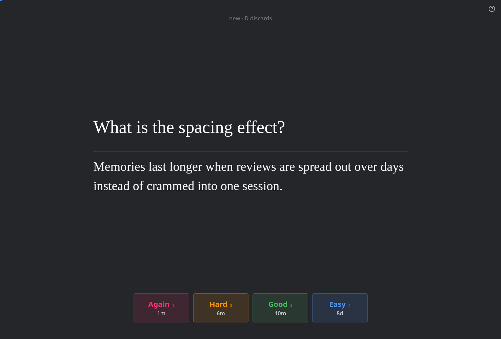

# Revisit

Flashcards that become a habit: pick a deck, pick your time, review.

Revisit is a spaced repetition plugin for Obsidian built around one small daily session. It is for people who want to remember what they read and write in their vault, and who have tried flashcards before and watched the pile of due cards grow until they stopped. There is no deck to set up, no pile of due cards to stare at and no syntax to learn.



## Why Revisit

**1. One question, then you are in.** Open a deck, press *Start* and answer *How much time?* (2, 5 or 10 minutes, keys 1 to 3; or a length of your own, or the time the deck's cards of today ask for). The session ends by itself when the time is up. Small, fixed sessions are easy to repeat every day, and repeating is what matters: in a study of 96 people doing a daily behaviour, habit strength rose with repetition, and missing a single day did not significantly hurt it ([Lally et al., 2010](https://doi.org/10.1002/ejsp.674)). The same study found the time to form a habit varied a lot, from 18 to 254 days, so the point is to make the daily step cheap, not to promise a number.

**2. No debt.** There is no overdue counter on the screens you review from. *~N min to clear* shows today's cards as time, not as a pile to count. After a missed day you see the cards that are due, for the time you chose, and the rest simply waits. When the time is up, *Keep going?* offers 2, 5 or 10 more minutes. It is your choice, never a demand.

**3. Cards take seconds to make.** Select text, run `New card`, type the question, press `Ctrl+Enter`. A short selection with an empty front becomes a cloze on its own. There is no deck to choose: cards are grouped by the top-level folder of the note. Folders inside the cards folder make subdecks.

**4. Your notes stay clean.** Revisit writes nothing to the note a card came from. Cards are plain markdown in their own folder (`Revisit/` by default), readable without the plugin. Scheduling lives in `state.json` and the review log in `review-log.jsonl`.

**5. A modern scheduler, without tuning.** Revisit uses [FSRS](https://github.com/open-spaced-repetition/ts-fsrs) with one setting: desired retention (default 90%). At most 10 new cards enter per day.

## How it compares

Checked in November 2026 against each project's README. These are good plugins; they solve different problems.

| | **Revisit** | [Spaced Repetition](https://github.com/st3v3nmw/obsidian-spaced-repetition) | [Obsidian_to_Anki](https://github.com/ObsidianToAnki/Obsidian_to_Anki) | [Flashcards (v2)](https://github.com/reuseman/flashcards-obsidian) |
|---|---|---|---|---|
| Create a card | Select text, `New card`, type the question | Write inline syntax in a note (`Question::Answer`, multi-line `?`) under a `#flashcards` tag | Write notes in markdown, then send them to Anki | Write `Question::Answer` in a note, then run an update command |
| Marks your note | No | Yes: scheduling is kept as an HTML comment next to the card | Yes: writes an ID, in an HTML comment by default | Yes: adds a `^q-xxxx` anchor and a `flashcards` property |
| Algorithm | FSRS | FSRS or SM-2 | Anki's | Anki's |
| Session by time | Yes: 2, 5, 10 min or your own | Not in README | Not in README | Not in README |
| Needs Anki | No | No | Yes, with AnkiConnect | Yes, with AnkiConnect |

Where the others are stronger:

- **Anki users.** If you already live in Anki, or want its mobile apps, add-ons and sync, use Obsidian_to_Anki or Flashcards. Revisit does not talk to Anki.
- **Cards inside notes.** If you like writing `Question::Answer` next to your prose, or want whole-note review, Spaced Repetition is built for that. Revisit keeps cards out of your notes on purpose.
- **Mobile.** Revisit is desktop only for now.

Revisit is not for you if you need Anki sync, inline card syntax, or review on your phone today. It is for you if you would rather open one small session each day and be done.

## Quick start

1. Select a sentence in any note and run `New card` (command palette, right-click, or the Done screen). Type the question. Press `Ctrl+Enter`.
2. Open Revisit from the ribbon icon, the status bar or the `Review` command. Choose how many minutes.
3. Flip with Space, grade with 1 to 4. When the time is up, you are done.

## How it works

1. **Decks.** Revisit opens on your decks, as folders. *All decks* holds everything mixed; any other folder shows its subdecks as folders and, below them, its own cards in a grid, each with its question, how it is going and when it comes back (today's first, new ones last). Click or tap a card to flip it and read the answer and its source; click again to flip it back. The `⋯` of a card edits it, moves it to another deck (its schedule goes with it), opens its source note or deletes it. *Show answers* (or Space) flips them all. Looking is not reviewing: nothing is graded or saved. ← and Esc go up one level, and from the second level on a small `Decks › AWS` trail jumps to any level above. The `+` in an opened deck adds a *New card* there or a *New subdeck*.
2. **Start.** *Start* (or *Review ahead*) takes that deck and everything under it, and asks *How much time?*: 2, 5 or 10 min (keys 1 to 3), *Custom* (key 4, 1 to 180 minutes) or *~N min to clear* (key 5), estimated from your own review log. The time you picked last is already selected, so Enter, Enter starts.
3. **Review.** One card at a time. Space or a click flips it, and flips it back. Grade with Again, Hard, Good or Easy (keys 1 to 4); each button shows its colour and the next interval. The session ends by itself when the time is up. To pause, press P (on a computer, a faint ⏸ also shows when the pointer is near the time line; on a phone, *Pause* is in the `⋯` menu): the card is hidden and the time stops until you press P or Enter, or tap. Esc leaves the session and goes back to the deck it started from, as does *End session* on the paused screen.
4. **Done.** A calm screen: *Done. N cards.* or *All caught up.*, and when the next card comes back. If cards from today were left, *Keep going?* offers 2, 5 or 10 more minutes. If not, *Ahead of schedule?* offers new cards past the daily limit, then cards before their day. `New card` and `Decks` links sit here too, and Esc goes back to the deck you came from.

## Creating cards

**Select the text, run `New card`, write the question, press `Ctrl+Enter`.** That is the whole rule.

`New card` (command, the editor context menu or the Done screen) opens two fields, Front and Back. A selection in the editor goes to Back. With the front left empty and a short selection (up to 8 words), the card is saved as a cloze of the sentence around it. `Ctrl+Enter` saves, `Esc` cancels.

There is no deck to pick. Cards are grouped by the top-level folder of the note you were in (a note at the vault root groups by its own name; with no note open, cards go to `Inbox`). Each group is a deck: review it alone, or pick *All decks* to mix them.

**Subdecks** come from the folders inside the cards folder, nothing else. `Revisit/AWS.md` and the folder `Revisit/AWS/` are one deck, AWS; `Revisit/AWS/EC2.md` is its subdeck EC2, at any depth. A folder with no file of its own is a deck too, as long as there are cards under it. To add one, open a deck, press `+` and *New subdeck*: the file is created when its first card is saved. To rename or move a deck, use Obsidian's file explorer (rename both `AWS.md` and `AWS/`); progress is kept.

## Keyboard shortcuts

| Key | Action |
|---|---|
| 1, 2, 3 | Choose 2, 5 or 10 minutes (after Start, and Keep going) |
| 4 | Custom time; Enter confirms |
| 5 | Time to clear the deck's cards of today |
| Space | Flip the card, and flip it back; in an opened deck, show or hide all answers |
| 1, 2, 3, 4 | Again, Hard, Good, Easy |
| P | Pause the review; P or Enter resumes |
| Esc | Back: leave the session, close the times, go up one deck |
| Arrows | On Decks, move between folders, cards, Start and the times; Enter or Space picks |
| E | Edit the card |
| O | Open the source note |
| D D | Delete the card (press twice) |
| Ctrl/Cmd+Z | Undo the last grade |
| ? | List every key |
| Ctrl/Cmd+Enter | Save a new card |
| Esc | Cancel a new card |
| Enter | On Decks: open All decks, or ask the time in an opened deck |

## Card format

Cards are plain markdown in the cards folder, one file per deck (folders are parent decks), blocks separated by `---`:

```
Front: What does `kubectl rollout undo` do?
Back: Rolls a deployment back to its previous revision.
Type: Question
Topic: Kubernetes > Workloads
Source: [[CKA study plan]] ^lk7q2a
```

`==highlights==` in the front of a `Type: Cloze` card make one card per highlight. The schedule lives in `state.json` and every grade in `review-log.jsonl`, in the same folder. Files from earlier versions (including cards of the old Reference and Problem types) are read as they are and kept untouched.

## Settings

- **Cards folder.** Where the card files, `state.json` and `review-log.jsonl` live. Default `Revisit`.
- **Desired retention.** 70 to 95%, default 90%. Higher means more reviews.

## Install

Revisit is on its way to the Community plugins list. Until it appears there, install it manually: download `main.js`, `manifest.json` and `styles.css` from the [latest release](../../releases) into `<vault>/.obsidian/plugins/revisit/`, then enable Revisit under Settings → Community plugins.

## FAQ

**Where is my data?** In your vault, in the cards folder. Revisit makes no network requests and has no telemetry.

**Can I edit cards by hand?** Yes. They are markdown files. Press `E` in a review to edit one there.

**Does it work on mobile?** Yes. On a phone the `?` becomes a `⋯` menu (pause, edit, open source note, delete, undo), buttons are larger and you tap to flip.

**Two devices?** Yes, with Syncthing or any file sync. Each device writes only its own files, `devices/<id>/state.json` and `devices/<id>/review-log.jsonl` inside the cards folder, and Revisit merges them when reading (the latest review of each card wins; logs are joined by time). Files from older versions in the folder root are still read and never touched. `*.sync-conflict-*` files are ignored. Reviewing on two devices is safe. One limit: creating or editing cards in the *same deck file* on both devices before they sync can still make Syncthing create a conflict in that file.

**Can I move over from another plugin?** There is no importer. Cards are plain markdown with a simple format (above), so you can write them into the cards folder yourself. Revisit does not read the scheduling data of other plugins.

## Support

[](https://www.buymeacoffee.com/alanveras)

## License

0-BSD. See [LICENSE](LICENSE).
